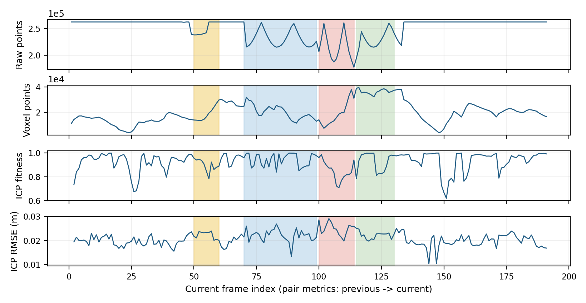
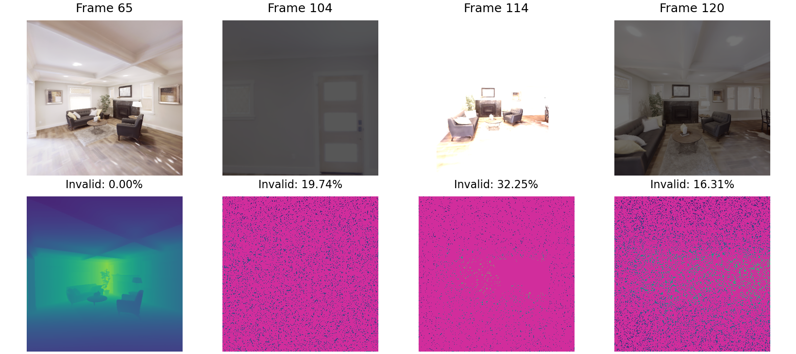
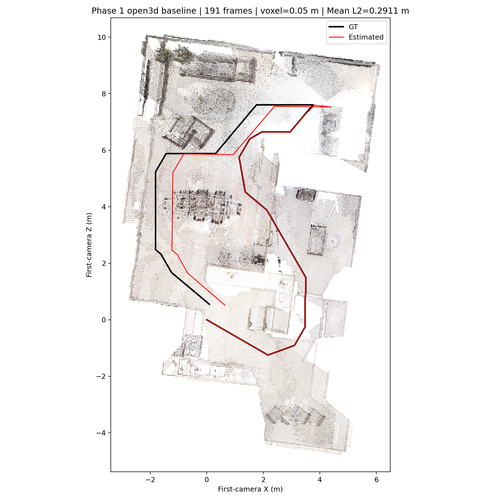
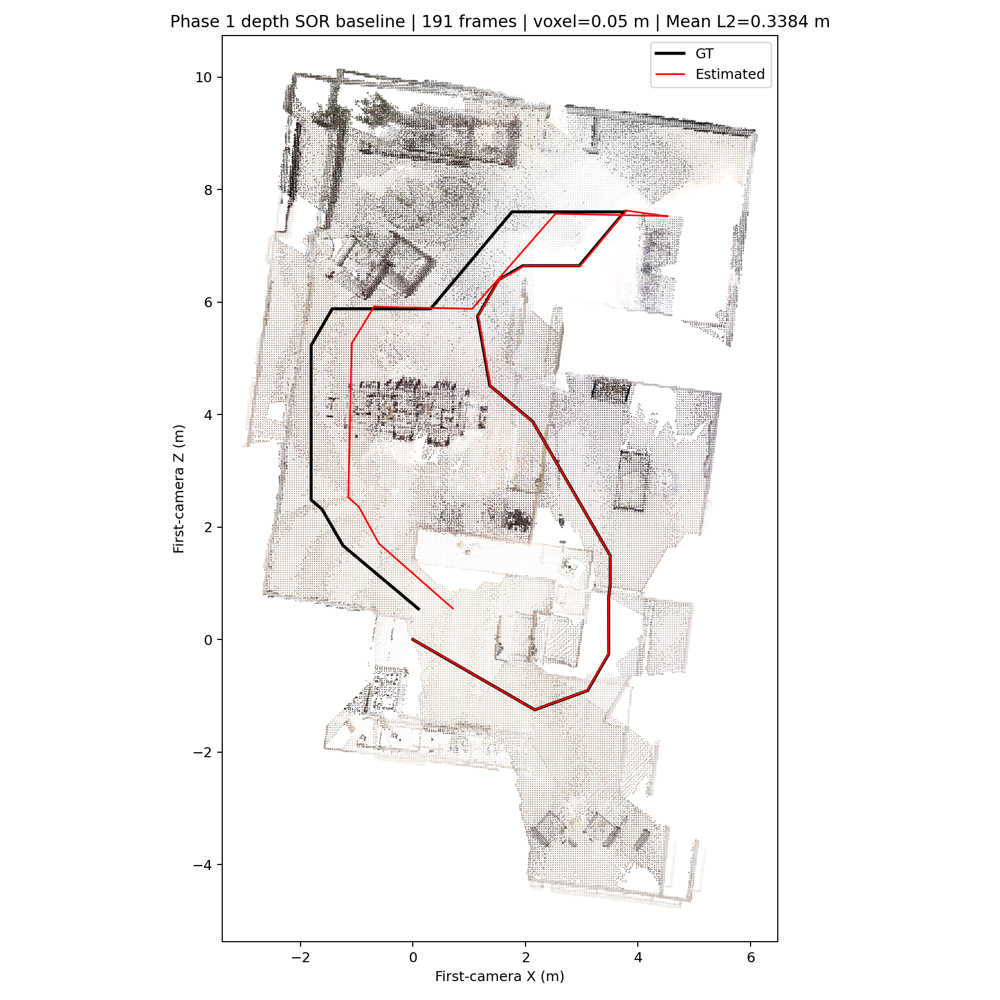
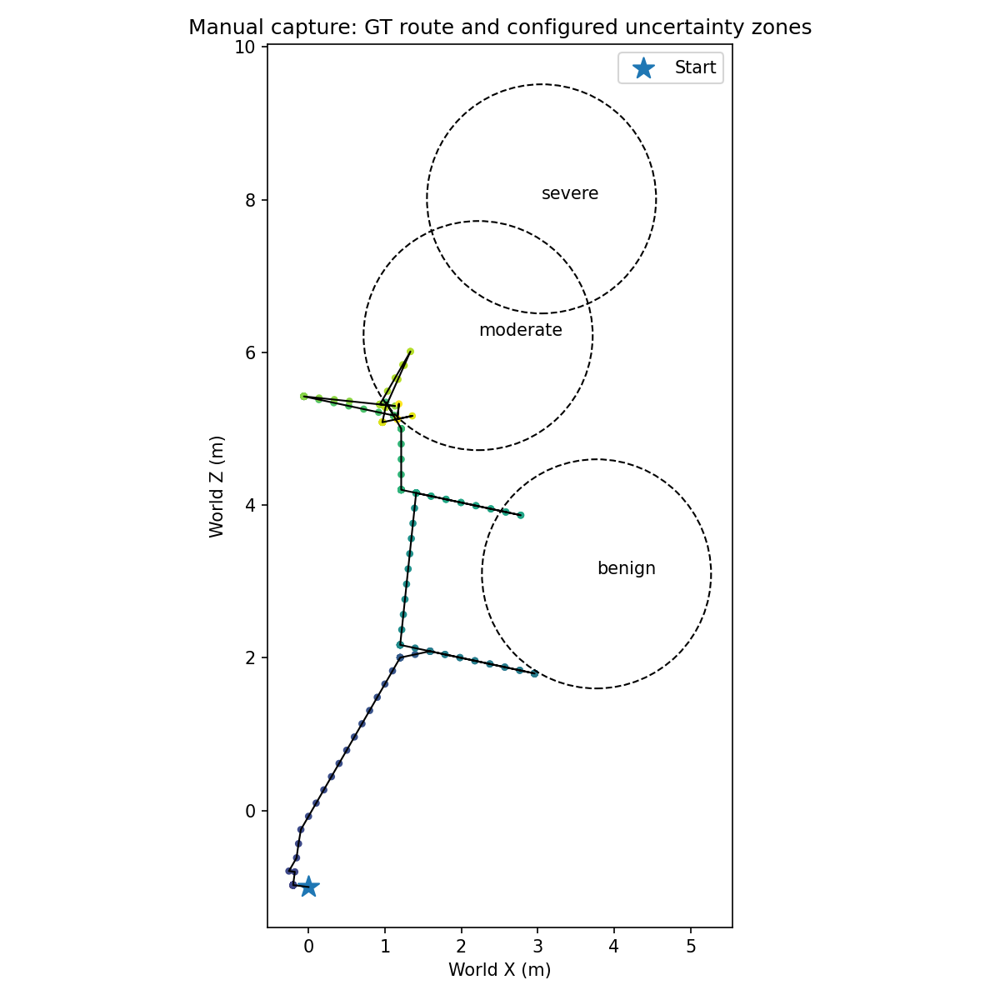
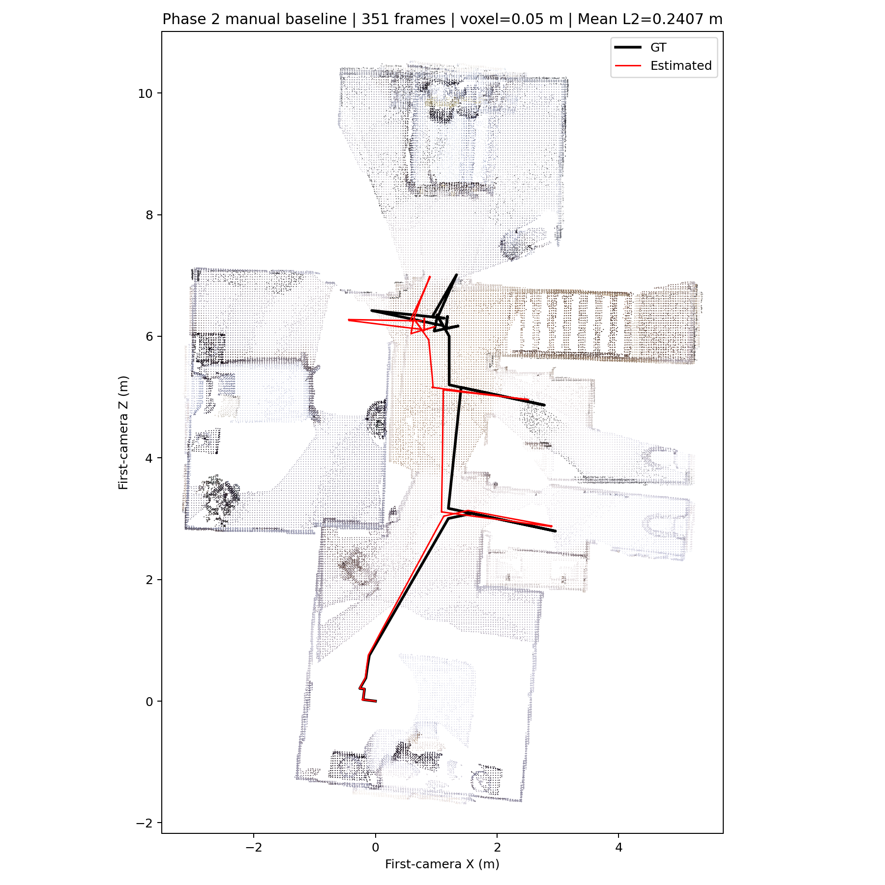
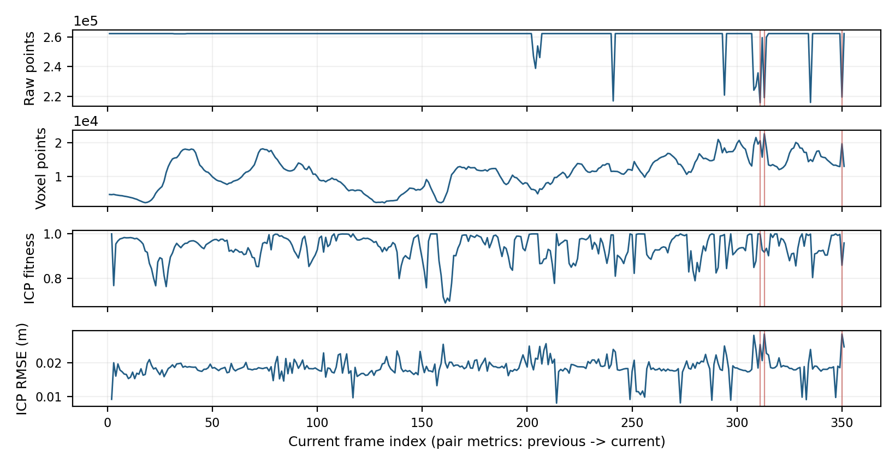
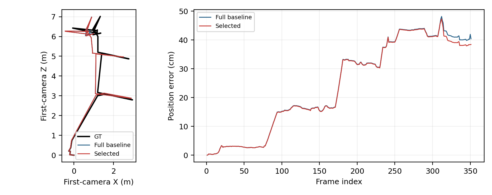
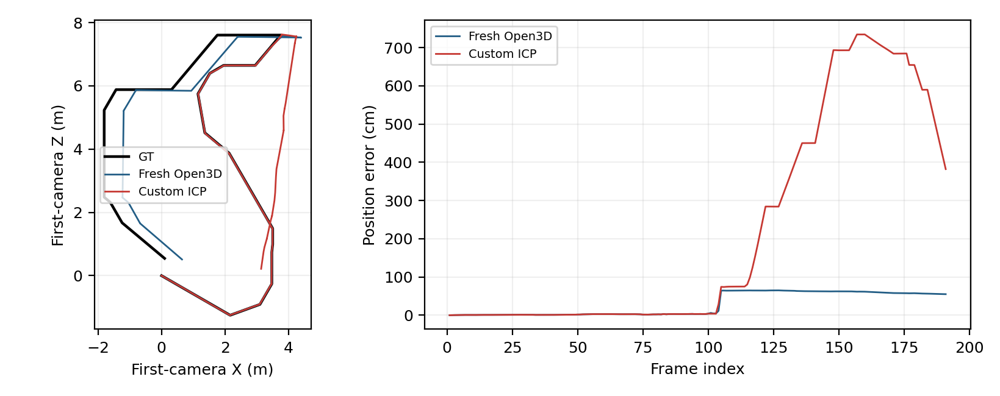

# HW1: 3D Scene Reconstruction
Student ID: 115062519 | 4 November 2026

## 3D Scene Reconstruction
IMPLEMENTATION / EXPERIMENT DESIGN

Objective. Reconstruct apartment_0 from RGB-D sequences, inspect pipeline-grounded evidence, and test whether data interventions improve alignment. Phase 1 uses 191 provided frames; the main Phase 2 result uses 351 manually captured frames. Historical Open3D baselines achieve Mean L2 of 0.0588 m and 0.2407 m, respectively. Interventions provide limited or negative gains; reruns also expose sensitivity to execution conditions.

1. Reconstruction pipeline

Depth unprojection. Read each capture's intrinsics.json. Convert uint16 millimeters to meters and discard non-finite or non-positive depth. Implement the pinhole projection directly, without Open3D's RGB-D projection helper:

f = W / [2 tan(HFOV / 2)]; c = (W/2, H/2)X = (u - cx) z / f; Y = (v - cy) z / f; Z = z

Registration. Voxel-downsample each frame, estimate normals, and compute FPFH. Match the current frame to the previous frame using feature-based RANSAC, then refine with Open3D point-to-plane ICP [2,3]. Compose transforms as Tglobal,i = Tglobal,i-1 Tprevious,current and merge transformed colored clouds. No loop closure or pose-graph optimization is applied.

| Setting | Original baseline |
| --- | --- |
| Capture resolution / HFOV | 512 x 512 / 90 degrees; capture-specific intrinsics |
| Voxel / normal / FPFH radii | 0.05 / 0.10 / 0.25 m; normal max_nn=30, FPFH max_nn=100 |
| RANSAC | Mutual feature matching; 3-point samples; edge ratio 0.9; distance 0.075 m; max 100,000; confidence 0.999 |
| Local ICP | Point-to-plane; correspondence gate 0.075 m; max 100 iterations |
| Seed / map display | Registration seed 0; remove 1 m ceiling band from merged cloud only |

2. Evaluation and implementation issues

Mean L2 = (1/N) sum ||p_est,i - p_GT,i||. Anchor GT to the first sensor pose and convert image-camera axes to Habitat axes with diag(1,-1,-1). Do not fit an extra rigid alignment to GT. Subset GT using the same retained frame indices; always preserve frame 1. Ceiling removal and rendering do not change registration or the trajectory score.

For RGB-D-only capture, load the semantic mesh only when semantic output is requested; this avoids an incompatible duplicate asset load. Habitat is initialized before pygame to avoid Linux GL-context conflicts. Keyboard focus and normal exit are required for interactive capture and final GT saving. Experiments use separate directories, declarations, sealed measurements, and saved diagnostics [1].

## Data verification
PIPELINE MEASUREMENTS / PHASE 1 EVIDENCE

Measure all eight factors during reconstruction, rather than assigning arbitrary quality labels. For N frames, record 2N single-frame and 6(N-1) pair occurrences: 1,522 for Phase 1 and 2,802 for the manual Phase 2 baseline. Pair values at frame i refer to the actual previous-to-current registration. Sources: course ontology, implementation, and Open3D registration metrics [1-3].

| Measured factors | Meaning / unit |
| --- | --- |
| RawPointCount | Valid back-projected points before voxelization; count |
| VoxelizedPointYield | Points after voxel downsampling; count |
| CoarseRANSACFitness / RMSE / Correspondences | Coarse inlier fraction / inlier Euclidean RMSE (m) / matched-pair count |
| ICPInlierFitness / RMSE / Correspondences | Refined inlier fraction / inlier Euclidean RMSE (m) / matched-pair count |

Figure 1. Recorded Phase 1 baseline factors. Shading marks frames 50-60, 70-99, 100-114, and 115-130. These are inspection intervals, not predefined failure labels.

Figure 2. Original RGB and depth examples (0-8 m; magenta indicates invalid depth). All 191 positive-depth counts match the sealed RawPointCount values. No image was repaired for this figure.

Frames 100-114 combine lower mean raw support (215,269 points), lower mean ICP fitness (0.851), and higher mean RMSE (0.0249 m). The saved diagnostic trajectory reproduces the historical 0.058835 m score and shows a persistent offset after this interval. However, frame 120 has 16.31% missing depth and fitness 0.9983: depth loss alone does not determine pose accuracy. Turns and visible structure remain alternative explanations.

## Phase 1: intervention results
FIRST FLOOR / SAME-CAPTURE COMPARISONS

The initial hypothesis was that observations with both missing depth and weak pair registration could be removed without losing essential connectivity. Candidate rule: RawPointCount < 222,822.4 (85% of pixels) AND [ICP fitness < 0.90 OR RMSE > 0.025 m]. Keep frame 1 and every third frame as bridges. Thresholds are exploratory, not course-defined pass/fail criteria. GT is not used by this rule.

| Run | N / kept | Voxel m | Mean L2 m | Total s |
| --- | --- | --- | --- | --- |
| Historical full baseline | 191 / 100% | 0.05 | 0.058835 | NR |
| Depth + ICP selection | 179 / 93.72% | 0.05 | 0.305000 | 280.44 |
| Selection, add frame 104 | 180 / 94.24% | 0.05 | 0.125820 | 280.07 |
| Finer voxel (linked scales) | 191 / 100% | 0.03 | 2.965126 | 1524.47 |
| Depth SOR (20 neighbors, 3 SD) | 191 / 100% | 0.05 | 0.338406 | 160.11* |

NR = not recorded; no later runtime is attached to the historical score. Total includes reconstruction, diagnostics, evaluation and PNG/NPZ output, excluding declaration/sealing/dashboard. *SOR includes 23.16 s preprocessing. Older runs were not all measured under a matched thread environment; runtime differences are descriptive. Voxel 0.03 also changes normal/FPFH radii to 0.06/0.15 m and matching gates to 0.045 m, so it is a coupled-scale intervention.

Figure 3. Ceiling-cropped first-floor maps, red estimated / black GT. Left: fresh Open3D reference (0.291071 m), not the historical 0.058835 m baseline. Right: depth SOR (0.338406 m). Maps show connected rooms but displaced trajectory segments; coverage is qualitative, not a completeness score.

Selection and post-hoc rescue. The 179-frame result is worse. Restoring only frame 104 reduces common-179-frame error from 0.3050 to 0.1250 m, still above the original baseline on those frames (0.0579 m). This rescue was motivated by post-hoc GT diagnosis and is not an independent, generalizable quality rule.

Point-level intervention. Apply per-frame statistical outlier removal before voxelization [4], zero only removed depth pixels, and retain all 191 frames. Mean removal is 1.48% of positive points (max 3.48%). Error rises from 3.35 to 21.98 cm over 103-104, then to 76.18 cm at 105. Masks also remove distant real surfaces; lost geometry is a plausible explanation, not a proven cause. The original capture and baseline hashes remain unchanged.

## Phase 2: manual capture
SECOND FLOOR / COLLECTION AND BASELINE

Capture path: eval/_data/second_floor/115062519_manual_20261104_082753. Collect by keyboard using second_floor.yaml: W/S move, A/D turn, C/Space save, Q/Escape finish. The GT path below records the actual route through connecting spaces and room-facing views; 351 RGB-D frames were retained. Captured views show several rooms, but complete floor coverage is not quantitatively verified.

| Capture check | Observed |
| --- | --- |
| RGB / depth / GT | 351 matching, continuous frame IDs; all PNG files decode; GT shape (351,7) |
| Camera / depth | 512 x 512, HFOV 90 degrees; uint16 depth in millimeters |
| Adjacent camera motion | Maximum translation 0.4715 m; maximum rotation 6.00 degrees |
| Depth validity | Mean positive-depth fraction 99.53%; minimum 82.38% |
| Configured zones: benign / moderate / severe / outside | 4 / 11 / 0 / 336 frames (using current configuration) |

Figure 4. Left: actual GT route with configured zone boundaries (world X-Z). Right: manual baseline map after ceiling removal, red estimated / black GT (first-camera coordinates). The route and map use different coordinate origins; they should not be overlaid directly.

Baseline. Use all 351 frames, voxel 0.05 m, Open3D, seed 0. Mean L2 is 0.240687 m; maximum error is 0.481583 m (frame 312). Reconstruction takes 106.88 s; measured total is 108.50 s. Main route structure is retained, with accumulated drift. Lower error alone does not establish complete coverage.

Earlier API capture. A separate automatic, NavMesh-guided capture has 281 frames and Mean L2 5.882325 m (215.06 s measured total). Near-wall viewpoints show registration ambiguity, including an approximately 180-degree relative-rotation error at 38-39. It is retained as exploratory evidence, not presented as manual collection or as a controlled comparison of navigation methods.

Limitation. No manual frame falls in the configured severe zone. The collection has no saved configuration snapshot; zone counts use the current YAML. Therefore, this result does not demonstrate performance across all three uncertainty levels, and manual/API score differences cannot be attributed solely to operator choice.

## Phase 2: conservative selection
INTERVENTION / COMMON-FRAME EVALUATION

Reuse the Phase 1 depth + ICP rule unchanged; do not tune thresholds against Phase 2 GT. Candidates are 294, 311, 313, and 350. Keep 294 because it is a bridge frame; exclude only 311, 313, and 350. Original RGB-D files and baseline artifacts remain unchanged. Reconstruct the selected sequence from scratch with the original voxel, backend, and seed.

| Evaluation | Frames | Mean L2 m | Total s |
| --- | --- | --- | --- |
| Full baseline | 351 | 0.240687 | 108.50 |
| Baseline on retained frames | 348 | 0.238854 | Not rerun |
| Selected reconstruction | 348 (99.15%) | 0.236077 | 104.35 |

Figure 5. Manual baseline factors; red lines mark excluded frames. Each has fewer than 85% valid depth points and ICP RMSE above 0.025 m. New splice diagnostics are saved separately.

Figure 6. Full and selected trajectories/errors. Curves use their own frame sets; the table compares common frames. GT is black.

The direct score difference is 4.61 mm; on common frames it is only 2.78 mm (1.16%). Before the first removed frame, reruns already differ by up to 1.32 mm in a coordinate component; this is an observation, not a confidence interval. Single-run evidence is insufficient to claim stable improvement. New pairs 310-312, 312-314 and 349-351 complete successfully; preserving connectivity remains important.

This sequence is mostly valid-depth and zone-exterior. Deletion avoids large degradation but offers little benefit. The baseline measures all factors; selection saves pair diagnostics. Runtime differences cannot be assigned solely to deleting three frames.

## Bonus: custom point-to-plane ICP
IMPLEMENTATION / ACCURACY AND RUNTIME

The existing my_local_icp_algorithm does not call Open3D registration_icp. Build a SciPy cKDTree on target points, transform source points, find nearest neighbors, and keep pairs within 0.075 m. With target normal n and transformed/source-target pair p,q, use residual r = n dot (p-q) and Jacobian J = [p cross n, n]. Solve J delta = -r by least squares and left-compose the incremental rotation/translation.

Stop after 60 iterations, fewer than 10 valid pairs, a mean absolute residual change below 1e-6, or a step norm below 1e-6. Open3D keeps its native convergence rules and 100-iteration cap. Both receive the same original 191 frames and shared preprocessing settings. Neither backend uses robust loss here; no step damping or degeneracy handling was added to the custom implementation.

| Run | Mean L2 m | Recon. s | Total s |
| --- | --- | --- | --- |
| Historical Open3D baseline | 0.058835 | NR | NR |
| Fresh Open3D reference | 0.291071 | 152.23 | 154.13 |
| Custom ICP | 2.174410 | 167.19 | 169.78 |

Figure 7. Fresh reference and custom-backend runs. The custom trajectory diverges after the frame-104 region; its maximum error is 7.342940 m at frame 160. This is an end-to-end comparison, not an isolated local-solver benchmark.

At 104-105, custom relative-rotation error is about 89.66 degrees, versus 0.20 degrees for the fresh Open3D run. Custom full reconstruction is about 9.8% slower. However, 188/190 actual RANSAC initial transforms differ between runs at a 1e-10 tolerance, despite seed 0. The fresh Open3D score also does not reproduce the historical baseline. Thus, the entire difference cannot be assigned to ICP alone.

Both runs use OMP_NUM_THREADS=8 and run sequentially. Timings include unprojection, features, RANSAC, ICP, map merge and the stated output work; no isolated ICP time was measured. These are single trials with different native stopping rules. Reusing identical initial transforms and repeating trials would be needed for a stronger causal comparison. All measured factors, valid rotations, score calculations, seals, and source hashes pass saved integrity checks.

## Discussion and required questions
INTERPRETATION / LIMITATIONS / REFERENCES

Q1. What if ICP runs without global registration?

ICP is a local alignment method: nearest-neighbor assignments depend on the initial pose [2,3]. Without RANSAC, an identity or poor initial transform can pair unrelated surfaces and converge to a wrong local minimum, especially during turns or in repeated/flat geometry. Small inter-frame motion may still allow convergence, so failure is not inevitable. No separate no-RANSAC experiment was run; this answer is a method-based expectation, not an observed ablation.

Q2. Which choices affect ICP stability?

Use downsampling to balance noise, support, and cost; scale normal/FPFH neighborhoods consistently; and use RANSAC initialization plus a bounded correspondence distance. The original settings are 0.05/0.10/0.25 m and a 0.075 m gate. Changing voxel to 0.03 also tightened all linked scales and produced a worse run, so more points did not guarantee stability. Robust losses, damped updates and degeneracy checks are possible extensions, but were not implemented or tested here. Inlier fitness/RMSE alone cannot certify pose correctness.

Q3. How do quality and collection affect Mean L2?

Missing depth reduces potential geometric support, but surviving scene structure and overlap determine whether that support is sufficient. Phase 1 low-support/turning intervals coincide with drift; deleting observations or distant points can remove useful constraints. Phase 2 manual views retain the main route with lower error than the earlier API capture, but route, frame count and zone coverage differ. These are associations, not a controlled proof that manual navigation is better. Common-frame scoring separates an evaluation-set change from a reconstruction change.

Overall findings and limits

Keep the original Phase 1 baseline as the historical reference and the manual Phase 2 baseline as the main collected result. Retain negative interventions rather than selecting only favorable outcomes. Report the small Phase 2 selection gain cautiously. Rerun sensitivity means historical intervention differences are descriptive; they were not all measured with matched execution settings or repeated trials. Scene coverage is visual only, severe-zone coverage is absent in the manual capture, and missing historical timing must remain NR.

References and reproducibility

[1] Course handout, HW1: 3D Scene Reconstruction, sections 2.2.2, 3.2-3.5, 4-5; local file HW1_3D Scene Reconstruction.pdf. Source implementation: utils.py, reconstruct.py, api.py and ontology/hw1.ttl.

[2] Open3D, [ICP registration](https://www.open3d.org/docs/release/tutorial/pipelines/icp_registration.html). [3] Open3D, [Global registration](https://www.open3d.org/docs/release/tutorial/pipelines/global_registration.html). [4] Open3D, [Point cloud outlier removal](https://www.open3d.org/docs/release/tutorial/geometry/pointcloud_outlier_removal.html). These explain metrics and methods; experiments use Open3D 0.18.0.

Saved evidence: experiments/phase1_baseline, phase1_depth_icp_selection, phase1_depth_icp_add104, phase1_voxel_003, phase1_depth_sor; phase2_baseline, phase2_manual_baseline, phase2_manual_depth_icp_selection; phase1_my_icp and phase1_open3d_reference. Exact figure/data source hashes: report/sources.json. Python 3.9.23, NumPy 1.26.4, SciPy 1.13.1; latest documented backend runs use Open3D 0.18.0 on Linux. No new reconstruction was run to write this report.

Submission note: place this PDF as report.pdf at the ZIP root with required code, ontology and README. Experiment Turtle files, diagnostics, captured RGB-D and Replica assets are evidence kept locally and excluded from the submission ZIP, as required by the handout.

